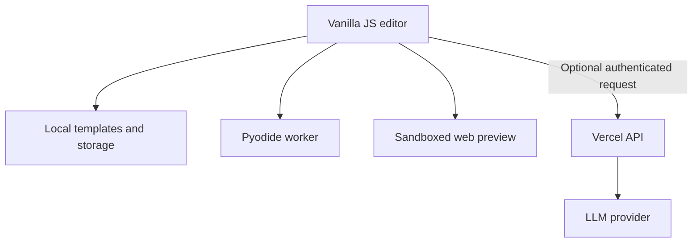

# AutoCoder 2.0 — Studio Niko Design

**Browser-native development workspace · Local-first editor · Optional server-side AI**

[](https://github.com/Nikoju1977/AutoCoder-Studio-Niko) [](LICENSE.md) [](py-worker.js)

[Application (URL de projet, disponibilité non vérifiée ici)](https://autocoder-studio-niko.vercel.app) · [Validation documentée](TESTS_VERIFIES.md) · [English overview](#english-overview) · [Portfolio](https://github.com/Nikoju1977)

[](app.js) [](app.js)

**STUDIO NIKO DESIGN** · Build smart. Stay lightweight. Create without limits.

> [Insérer ici un GIF de démonstration / Insert demo GIF here]

**Pourquoi ce projet ?** Réduire le coût d'entrée du développement : éditer, générer des modèles déterministes, exécuter Python et contrôler un aperçu web sans installer un IDE lourd. Le mode distant enrichit cette base mais n'est pas nécessaire à l'édition locale.

## Vision & architecture

Un atelier de développement qui privilégie le navigateur, la sobriété et le contrôle explicite des données. L'interface est en JavaScript natif sans framework de production ; Python nécessite Pyodide et les tests E2E utilisent Playwright. L'IA distante est facultative.

| Couche | Responsabilité |
| --- | --- |
| [app.js](app.js) | Édition, modèles déterministes, état local, orchestration |
| [py-worker.js](py-worker.js) | Exécution Python dans un Worker, interruption |
| [preview.html](preview.html) | Prévisualisation HTML/CSS/JS |
| [api/generate.mjs](api/generate.mjs) | Génération distante optionnelle, jeton serveur |
| [web-guidance.js](web-guidance.js) | Analyse statique heuristique |
| [sw.js](sw.js) | Cache de la coquille PWA |



### Frontières de confiance et dépendances

- `app.js` : état local, récupération et limites de fichiers ; aucun chiffrement du stockage n'est revendiqué.
- `py-worker.js` : Pyodide 0.25.1 chargé depuis un CDN. Le Worker évite de bloquer directement le thread UI mais ne constitue pas une isolation de sécurité pour du code hostile.
- `api/generate.mjs` : routage serveur vers OpenAI, Agnes AI ou Mistral, validation des entrées/sorties, jeton comparé avec `timingSafeEqual` après hachage ; ni authentification individuelle ni quota par utilisateur ne sont établis.
- `package.json` : Playwright est une dépendance de développement, pas une dépendance de l'interface statique.
- `studio-niko-core.js` : utilitaires locaux de stockage, JSON et diagnostic.

Le parcours navigateur décrit ici utilise un seul appel de génération. [Code Mode Pro](docs/CODE_MODE_X.md) documente séparément les rôles d’agent, l’accès aux dépôts publics et les commandes de validation.

## Statut des preuves

La documentation de validation rapporte des contrôles historiques, dont une batterie Pyodide et 12 contrôles Node réussis sur une révision locale du 7 novembre 2026. Elle ne prouve pas la réussite de chaque révision actuelle. Aucun nouveau test d'exécution, benchmark, appel fournisseur ou test sur téléphone physique n'a été effectué pour cette révision documentaire.

## Démarrage rapide

```bash
git clone https://github.com/Nikoju1977/AutoCoder-Studio-Niko.git
cd AutoCoder-Studio-Niko
python -m http.server 4173
```

L'utilisation et la redistribution restent soumises à [LICENSE.md](LICENSE.md).

Application web statique/PWA en français, fondée sur le design d'AutoCoder. Aucun framework ni compilation requis.

## Fonctionnalités clés réellement implémentées

- Editeur de code multifiche, téléchargement individuel, navigation et création/suppression de fichiers (`.py`, `.html`, `.css`, `.js`, `.md`, `.json`).
- Sauvegarde automatique dans le `localStorage` du navigateur ; import et export d'un projet JSON.
- Génération **locale** de projets prédéfinis : calculatrice Python, gestionnaire de tâches, analyse de texte, traitement CSV, exemple Python et site web responsive. **Ce mode n'utilise pas d'IA** : une demande hors de ces modèles déclenche le modèle Python générique.
- Pipeline à 4 étapes visibles : planification par règles/modèle ou IA serveur, génération de fichiers, exécution, contrôle. Ce sont des étapes d'application, **pas quatre agents LLM indépendants**.
- Exécution Python dans un Web Worker via Pyodide WebAssembly **v0.25.1**. Journaux stdout/stderr, commande d'arrêt (termination du worker) et limite de temps **d'exécution** 10/20/30 secondes. Chargement initial limité à 90 secondes.
- Tests Python `unittest` pour `main.py`/`test_main.py` et affichage du vrai nombre de tests/erreurs.
- Prévisualisation HTML/CSS/JS dans deux iframes sandboxées via un hôte dédié ; la CSP de l’éditeur reste stricte (sans accès réseau, origine partagée, formulaires et popups).
- Contrôles statiques heuristiques des principaux risques (ce n'est **pas** un audit complet).
- PWA installable depuis un hébergement HTTPS. La coquille web est mise en cache ; **premier chargement Pyodide nécessite Internet**. L'exécution hors-ligne de Python n'est pas garantie.
- Option de génération IA **réelle** via API Vercel, sous authentification par jeton. La clé du fournisseur reste côté serveur. Le mode local fonctionne indépendamment de cette configuration.

## Lot Modern Web Guidance (22 novembre 2026)

- **Agents de développement** : voir `AGENTS.md` pour rechercher et récupérer les guides officiels de [GoogleChrome/modern-web-guidance](https://github.com/GoogleChrome/modern-web-guidance) avec la CLI (Node.js + réseau nécessaires).
- **Analyse web dans AutoCoder** : `web-guidance.js` signale des problèmes possibles d'accessibilité HTML, de sécurité JavaScript, de scripts bloquants et d'ergonomie CSS. L'analyse est **locale, hors réseau et heuristique** ; elle ne lance ni la CLI Google ni un navigateur de test.
- **Génération IA serveur** : `api/web-standards.mjs` ajoute des consignes web de base aux requêtes concernant HTML/CSS/JS/PWA. Il ne télécharge **aucun guide officiel en temps réel**.
- **Mobile** : les onglets de fichiers sont de nouveau accessibles dans l'explorateur sur les petits écrans ; taille de police des champs adaptée pour éviter le zoom automatique sur iPhone.
- **Tests** : `npm test` inclut les contrôles du module web. La CI vérifie également la syntaxe JS. Le test sur des appareils physiques reste à réaliser.

Limites : ces contrôles ne remplacent pas Lighthouse, axe-core, un audit WCAG, des tests Safari/Firefox/Chrome, ni des mesures réelles de performance. Le mode IA reste dépendant de la configuration optionnelle du serveur et d'un fournisseur accessible.

## Lancer localement

Dans le répertoire du projet :

```bash
python -m http.server 4173
```

Ouvrir `http://localhost:4173` dans un navigateur moderne. Ne pas double-cliquer sur `index.html` en `file://` : les Workers, la PWA et l'API ne fonctionneront pas correctement.

La première exécution Python télécharge Pyodide depuis `cdn.jsdelivr.net`. Si Internet/CDN est indisponible, l'éditeur, les modèles et les aperçus web restent utilisables.

## Déploiement Vercel et mode IA facultatif

La route `GET /api/status` indique uniquement si les variables nécessaires sont configurées ; elle ne retourne jamais leur contenu. La fenêtre Réglages l’utilise pour afficher clairement lorsque le mode IA est indisponible. Sans clé API valide, la génération IA reste désactivée tandis que la génération locale fonctionne.

1. Déployer **le dossier complet** comme projet Vercel (pas uniquement `index.html`). Les pages statiques seront servies normalement et `api/generate.mjs` en fonction Node.
2. Dans les paramètres d'environnement Vercel, définir :
   - `AGNES_API_KEY`, `OPENAI_API_KEY` ou `MISTRAL_API_KEY` : clé du fournisseur, **uniquement côté serveur**. Pour privilégier Agnes, définir `AUTOCODER_DEFAULT_PROVIDER=agnes`.
   - `AUTOCODER_ACCESS_TOKEN` : secret fort et aléatoire de 32 caractères ou plus (requis par l'API).
   - `OPENAI_MODEL` : facultatif, défaut `gpt-4.1-mini` ; vérifier que ce modèle est disponible sur le compte API.
3. Redéployer le projet après ajout des variables.
4. Dans l'interface, choisir « IA via API serveur protégée » et saisir **AUTOCODER_ACCESS_TOKEN**, jamais la clé du fournisseur.

Le jeton d'accès est gardé uniquement en mémoire de l'onglet : il doit être ressaisi après rechargement, fermeture ou changement d'appareil.

**Attention** : un endpoint authentifié par un jeton partagé ne remplace pas une authentification utilisateur ni un quota côté serveur. Avant un déploiement public, mettre en place des comptes, quotas, suivi du budget et limitation de débit via une infrastructure adaptée (ex. Vercel Firewall / WAF, stockage persistant). Cette version ne met pas en œuvre ces services.

## Sécurité et limites

- Le code Python exécuté dans Pyodide n'a pas accès au système de fichiers de l'ordinateur, mais un Worker **n'est pas une sandbox robuste contre du code hostile** : du code Python/Pyodide peut disposer d'API réseau ou faire tomber le navigateur. **Ne jamais exécuter des scripts inconnus ou contenant des secrets.**
- Le stockage local n'est pas chiffré ; ne pas saisir de données sensibles, d'informations de santé ou de clés dans les projets.
- Les projets exportés sont des archives JSON, pas des fichiers ZIP/commits GitHub. Aucune synchronisation automatique GitHub/Vercel n'est implémentée.
- Les vérifications statiques par motifs, les tests unitaires fournis et la prévisualisation web ne prouvent pas que n'importe quel projet généré est sans erreur, ni sécurisé.
- Le navigateur ne peut pas exécuter directement des applications Python nécessitant Docker, Node.js, accès matériel ou modules natifs non compatibles Pyodide.
- La génération IA peut produire du code incorrect ; son résultat doit être relu et testé avant toute publication.

## Vérifier le projet

Un test en navigateur est disponible via `npm run test:e2e` après installation de Playwright et de Chromium. Il nécessite que le site soit accessible à l’URL donnée par `AUTOCODER_URL` (par défaut `http://127.0.0.1:4173`).

`npm test` : douze tests Node.js sans dépendance externe. Voir `TESTS_VERIFIES.md` pour la portée exacte des contrôles, les tests Python réalisés et les limites de vérification.

## Fichiers

- `index.html` — structure de l'interface, accessibilité et CSP côté document.
- `styles.css` — design et adaptations PC/mobile/tablette.
- `app.js` — gestion des projets, templates, logs, analyse, aperçu et API optionnelle.
- `py-worker.js` — runtime Python isolé du thread UI, tests et timeout orchestré par le thread principal.
- `preview.html`, `preview-host.js` — hôte et iframe de prévisualisation isolés.
- `api/status.mjs` — statut de configuration IA sans divulgation de secrets.
- `api/generate.mjs` — fonction serveur de génération IA (optionnelle).
- `manifest.webmanifest`, `sw.js`, `icons/` — ressources PWA.
- `vercel.json` — en-têtes de défense en profondeur.

### Sécurité du déploiement Vercel

La page principale interdit l'intégration en iframe (`X-Frame-Options: DENY` et `frame-ancestors 'none'`). Seul `/preview.html` peut être intégré depuis la même origine (`frame-ancestors 'self'`). Les deux iframes de prévisualisation restent sandboxées sans `allow-same-origin` et avec une CSP qui interdit les accès réseau.


## Reprise du code après fermeture — 22 novembre 2026

AutoCoder conserve désormais, si le stockage du navigateur le permet, une copie précédente des **fichiers de code et du nom du projet**. Dans les **Réglages**, la section repliable « Récupération de code après interruption » permet de la restaurer après confirmation ou de l'exporter en JSON. Les sauvegardes sont espacées pour limiter les écritures et une copie est tentée avant import, suppression de fichier ou génération. Les téléchargements disposent d'un lien manuel pendant environ cinq minutes.

La copie n'inclut pas les jetons saisis dans les réglages, mais **conserve tout secret inscrit dans le code en clair**. Aucun stockage distant n'est créé. En cas de quota dépassé ou de purge Safari, la récupération peut échouer : conserve des exports JSON indépendants. Cette révision est enregistrée sur GitHub ; aucune validation de son fonctionnement sur iPhone n'est revendiquée. [Procédure complète](docs/RECUPERATION_PROJET.md).


## Roadmap & contribution

Propositions à valider (non terminées) :

- [ ] Reproduire les tests Node et Pyodide sur le SHA publié.
- [ ] Mesurer le temps de premier chargement et le temps de réponse du Worker.
- [ ] Vérifier la récupération après fermeture et la PWA sur appareils physiques.
- [ ] Tester la route IA avec configuration réelle et ajouter des quotas avant ouverture publique.

**Première contribution / `good first issue` (label proposé, existence non vérifiée) :** Documenter un cas de récupération de projet ou une erreur de prévisualisation avec un exemple minimal reproductible.

[Issues](https://github.com/Nikoju1977/AutoCoder-Studio-Niko/issues) · [Historique des commits](https://github.com/Nikoju1977/AutoCoder-Studio-Niko/commits/main/)

## English overview

AutoCoder is a browser-native development workspace with multi-file editing, local deterministic project templates, JSON import/export, recovery snapshots, Python execution through Pyodide and sandboxed web previews. It uses vanilla JavaScript; Python's first load requires a CDN. Optional server-side AI requires a configured provider API key and an access token configured on Vercel. The four pipeline stages are not four independent LLM agents. Local browser storage is not encrypted, and the worker is not a secure sandbox for hostile code.

See the French instructions above for setup, configuration and limitations. Historical checks are documented in [TESTS_VERIFIES.md](TESTS_VERIFIES.md); current runtime and production availability are not established by this documentation update.

Local-first is a design choice, not a claim of zero network access: Pyodide needs an initial download and optional server-side generation sends request context to the provider through the server. The UI uses no production framework. Suggested first contribution: reproduce a recovery or preview defect.

## Contribution et droits / Contributions and rights

Les signalements reproductibles sont bienvenus via les issues si elles sont activées : navigateur, version, étapes, résultat attendu et observé, sans secrets. Le dépôt est consultable publiquement mais **n'est pas sous licence open source** ; toute contribution, réutilisation ou redistribution doit respecter [LICENSE.md](LICENSE.md) et les licences des tiers.

**Studio Niko Design** · Local-first when possible, evidence before claims.
